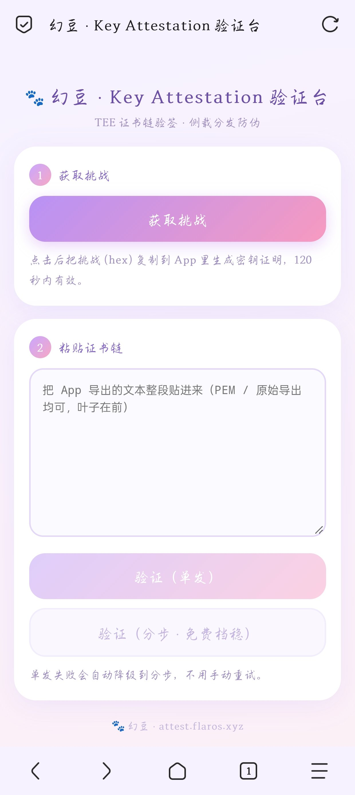

# 幻豆 · Android 浏览器客户端

[](https://github.com/duskly-jpg/huandou/actions/workflows/tests.yml)

<p align="center">
  
</p>

一个不依赖 Gradle、不依赖 Android Studio 的 WebView 浏览器。用 aapt2、javac、R8、zipalign、apksigner 五条命令串成构建链，从源码到签名 APK 全流程可在终端完成。

未加固包 394 KB。目标设备 Android 7.0（API 24）及以上。

## 功能

**浏览与页面处理**
- WebView 内核，支持多标签、下拉刷新、自定义 UA、网页内查找
- 用户脚本引擎：Greasy Fork 风格的 `@match` 匹配、脚本注入、存储隔离
- 页面处理：夜间模式、阅读模式、广告拦截规则

**媒体嗅探与离线缓存**
- 同时观察网络请求与 DOM 变化定位媒体源，覆盖直链、m3u8、blob 三类
- HLS AES-128 解密、MPEG-TS 流式解复用、MP4 封装，纯 Java 实现，不引入 ffmpeg
- 分片下载、断点续传、通知栏进度，实测单文件 171 MB 完整落盘

**设备可信链**
- 在 AndroidKeyStore 内生成 EC P-256 密钥，由 TEE 签发 Key Attestation
- 解析 X.509 709 扩展（OID `1.3.6.1.4.1.11129.2.1.17`），取安全等级、challenge 回显、APK 签名摘要
- 交由服务端验签后签发 7 天短期凭据，无凭据不进入主界面

**离线安全浏览**
- 十余万条钓鱼与恶意域名的本地库，仅存 FNV-1a 指纹（单条 8 字节，全库约 1 MB）
- 命中判断零网络请求，适合弱网与离线场景

## 构建

前置条件：

| 组件 | 版本 | 路径 |
|---|---|---|
| JDK | 8 及以上 | `javac` 在 PATH |
| Android SDK build-tools | 34.0.0 | `$ANDROID_SDK/build-tools/34.0.0` |
| Android platform | android-34 | `$ANDROID_SDK/platforms/android-34/android.jar` |
| cmdline-tools | latest | `$ANDROID_SDK/cmdline-tools/latest/lib/r8.jar` |

签名密码走环境变量，仓库里不放 keystore：

```bash
export ANDROID_SDK=/opt/android-sdk        # 按本机实际路径改
export HUANDOU_KS_PASS='你的签名密码'        # 首次构建会据此生成 keystore
./build.sh
```

产物：`build/幻豆_1.9.8.apk`，版本号只改 `build.sh` 顶部的 `VER_CODE` 与 `VER_NAME`。

首次构建会在 `keystore/release.jks` 生成新密钥。换机或换 keystore 后签名指纹变化，依赖签名的功能（如可信链的 APK 摘要校验）需同步更新服务端配置。

## 目录

```
AndroidManifest.xml
build.sh                 构建脚本（唯一入口）
proguard-rules.pro       R8 keep 规则
src/com/huandou/app/      37 个 Java 类
res/                      资源与图标
libs/                     BouncyCastle（X.509 解析，无 Gradle 依赖管理，直接放 jar）
test/                     纯 JVM 单测（HostRules、GateRules）
tools/check_oid.py        构建前校验 Key Attestation 的 OID 常量
tools/method_size.py      统计方法字节码长度（判断能否进指令级虚拟化）
```

## 测试

```bash
javac --release 8 -encoding UTF-8 -d /tmp/t test/*.java src/com/huandou/app/HostRules.java src/com/huandou/app/GateRules.java
java -cp /tmp/t com.huandou.app.HostRulesTest
java -cp /tmp/t com.huandou.app.GateRulesTest
```

49 项断言，覆盖域名边界匹配（含 `evil-example.com` 冒充 `example.com` 这类子串陷阱）与准入规则判定。

## 设计取舍

- **不用 Gradle**：构建链每一步都能单独跑、单独看中间产物，出问题能定位到具体阶段；代价是没有依赖管理，第三方 jar 直接放进 `libs/`。
- **媒体处理自己写**：MPEG-TS 解复用与 MP4 封装都是几百行的确定性代码，比引入 ffmpeg 二进制（体积 + 版权 + ABI 适配）更可控。
- **安全浏览走本地指纹**：每次导航都请求云端情报在弱网下体验不可接受，整包下发 + 本地哈希命中，代价是库的更新依赖定期拉取。

## 已知限制

- 混淆后不保留行号，崩溃栈需配合 `mapping.txt` 还原（该文件不入库）
- 媒体嗅探依赖页面结构特征，站点改版后需要调整
- 目标 API 34，未适配 Android 15 的前台服务新限制

## 许可

MIT
